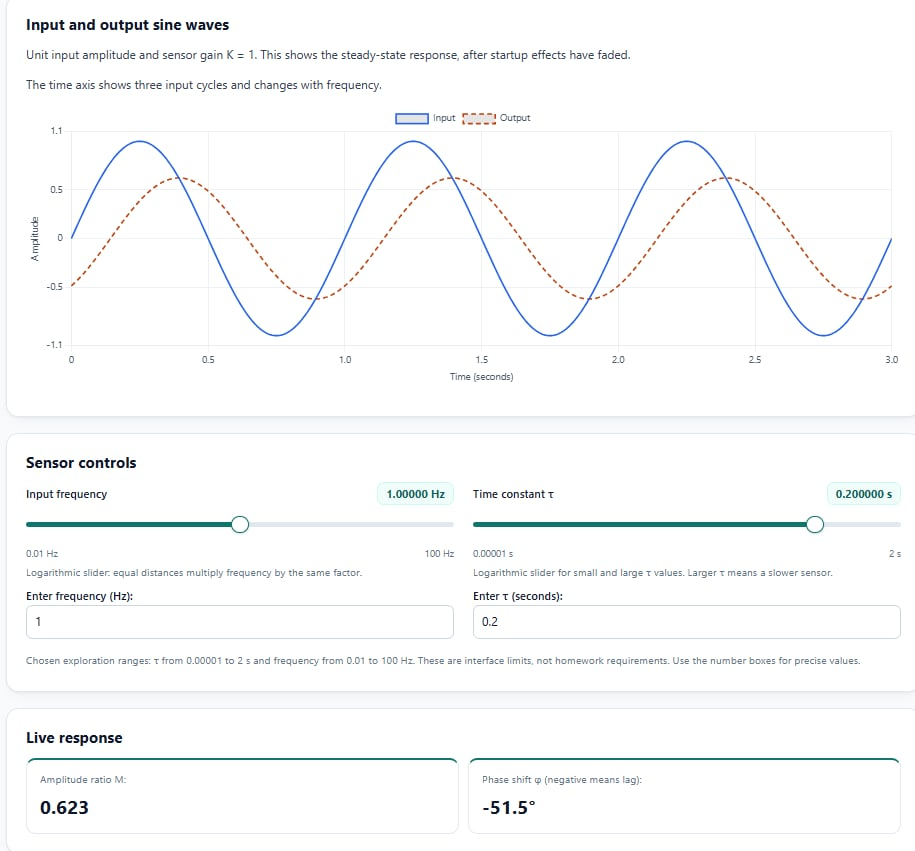
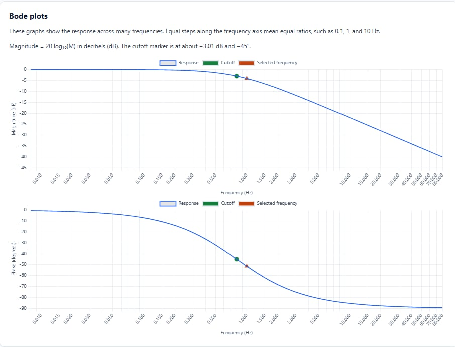
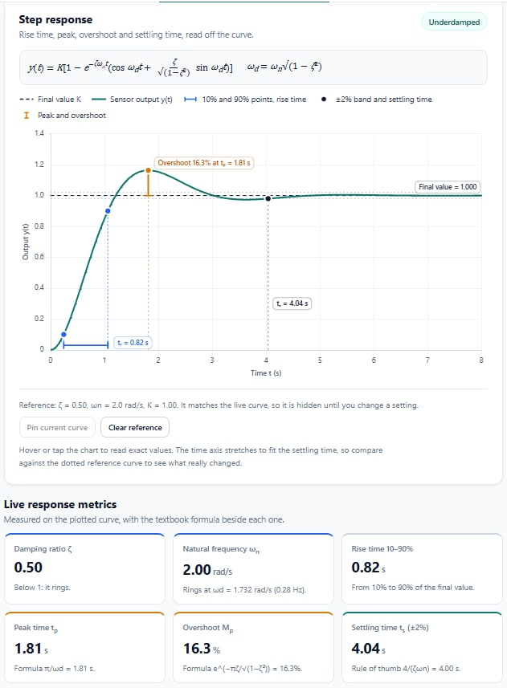
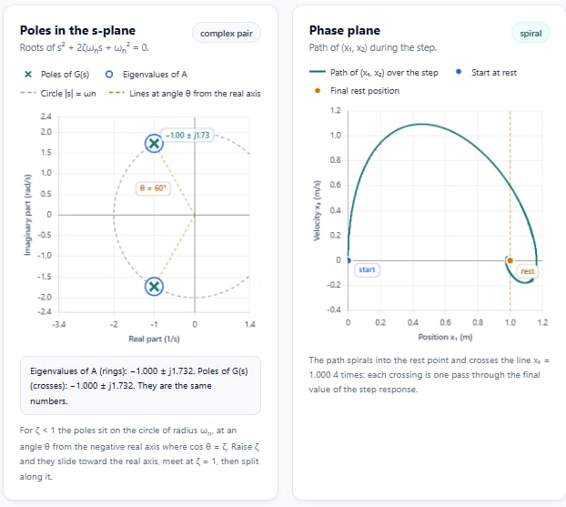

# Dynamic Characteristics Interactive Toolkit

**ENCS4380 — Interfacing Techniques | Homework 1**  
Birzeit University · Dr. Wasel Ghanem · Team 40

**Live website:** https://omaryahya965-beep.github.io/encs4380-dynamics-team40/

We built an interactive toolkit to explore how sensors respond to changing inputs. Instead of only reading equations, visitors can change sliders, watch the response curves update, and predict what will happen before checking the results. The project runs in the browser using HTML, CSS, and JavaScript, with no server or installation required.

## Our team

Each member was responsible for one module:

| Module | Team member | What the module does |
|---|---|---|
| **1 — First-Order Time Response** | **Omar Yahya** | Explore step and ramp inputs by changing gain K and time constant τ. Inspect the 63.2% and 95% response points, ramp lag, steady-state error, and logarithmic error plot. |
| **2 — First-Order Frequency Response** | **Shadi Ataya** | Change input frequency and τ to compare input/output sine waves, amplitude ratio, phase lag, Bode plots, cutoff frequency, and dynamic error. |
| **3 — Second-Order Response and State-Space** | **Alaa Qalalwa** | Explore damping cases, rise and settling times, overshoot, poles, mass–spring–damper state-space matrices, eigenvalues, and phase-plane trajectories. |
| **4 — Guess the Sensor** | **Amr Yahya** | Estimate hidden sensor parameters from noisy response curves, check guesses against the true values, reveal comparison curves, request hints, and track the session score. |

Each module includes a **Predict, then check** activity so visitors can make a prediction and compare it with the response.

## Screenshots

Screenshots below illustrate the modules and features in the toolkit. Click an image to open the full-resolution version.

### Module 1 — First-Order Time Response

**Step response with gain and time-constant controls, 63.2% and 95% markers, and live response metrics**

### Module 2 — First-Order Frequency Response

**Input and output sine waves, with frequency and time-constant controls**

**Bode magnitude and phase plots**

### Module 3 — Second-Order Response and State-Space

**Underdamped step response and live response metrics**

**System poles, eigenvalues, and phase-plane trajectory**

### Module 4 — Guess the Sensor

**Example completed challenge: measured samples, guessed and true curves, and score**

## Validation results

We used the reference examples in the lecture material to check our calculations. The toolkit displays expected values, calculated values, and PASS/FAIL indicators.

| # | Test | Expected | Calculated | Module |
|---|---|---|---|---|
| 1 | First-order step response at τ and 3τ | 0.632 KA and 0.95 KA | 0.6321 KA and 0.9502 KA | 1 |
| 2 | τ = 0.2 s, input = sin(2t) | M ≈ 0.93, phase lag ≈ 21.8° | 0.9285, 21.80° | 2 |
| 3 | Maximum 5% dynamic error at 100 Hz; phase at 50 Hz | τmax ≈ 0.52 ms, lag ≈ 9.3° | 0.5231 ms, 9.33° | 2 |
| 4 | Second-order system, ζ = 0.5 | Overshoot ≈ 16.3% | 16.30% | 3 |
| 5 | Second-order system, ζ = 1 | No overshoot | 0% | 3 |
| 6 | m = 1, b = 2, k = 4 | Eigenvalues = −1 ± j1.732, matching the poles | −1 ± j1.732 | 3 |

We also used AI-assisted numerical checks during final review to compare these results with independent calculations.

## How to run the project

1. Open the [live website](https://omaryahya965-beep.github.io/encs4380-dynamics-team40/) in a browser.
2. Switch between the four modules using the tabs on the homepage.
3. Move sliders, inspect graphs, and try the **Predict, then check** activities.

You can also download `index.html` and open it locally. An internet connection is needed to load Chart.js for the integrated website graphs.

## How we organized the code

Our integrated website uses one `index.html` file containing the HTML for all four modules, CSS inside `<style>` tags, and JavaScript inside `<script>` tags. Each module's styles and JavaScript are separated within the file to avoid conflicts. We kept the individual module files in the repository so each member's work can be reviewed separately.

The screenshots used in this README are stored under `screenshots/`.

## How we used AI

We used **AI coding tools, including Claude**, to help write HTML, CSS, and JavaScript, particularly interactive controls, charts, and page layout. AI also helped us review code, fix bugs, and combine modules into the final page.

For the engineering concepts, we researched and studied the course material and other learning resources ourselves. We focused on what the equations mean, how the sensor responses behave, and whether the calculations are reasonable. We used the homework's validation examples to check the implementation rather than relying only on generated code.

Each team member is responsible for understanding and explaining their own module, including its equations, graphs, and code, during the demo.
