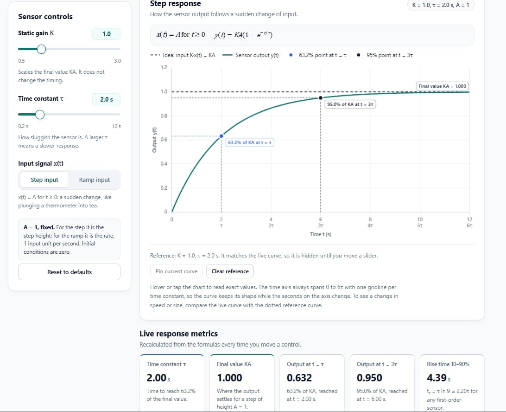
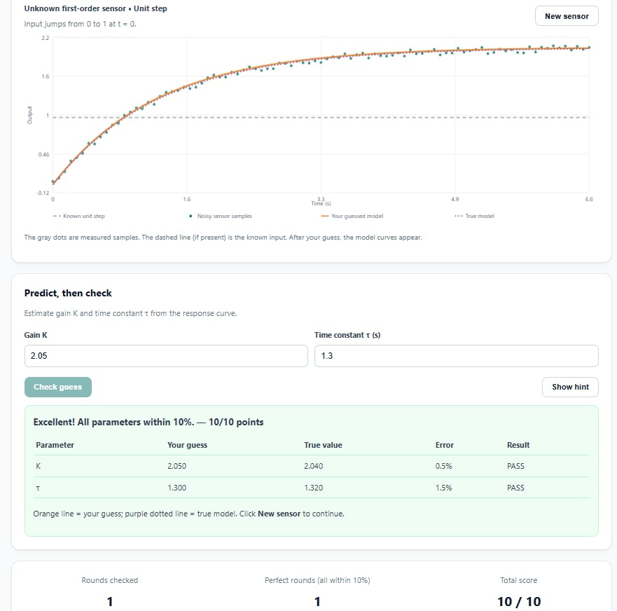

# Dynamic Characteristics Interactive Toolkit

**ENCS4380 — Interfacing Techniques | Homework 1**  
Birzeit University · Dr. Wasel Ghanem · Team 40

**Live website:** https://omaryahya965-beep.github.io/encs4380-dynamics-team40/

For this homework, we built an interactive toolkit to explore how sensors respond to changing inputs. Instead of only reading equations, you can move sliders, see the response curves change, and try to predict what will happen. The project runs directly in the browser using HTML, CSS, and JavaScript, with no server or installation needed.

## Our team

We divided the homework into four modules, with one member responsible for each one:

| Module | Team member | What the module does |
|---|---|---|
| **1 — First-Order Time Response** | **Omar Yahya** | Explore step and ramp inputs by changing K and τ. See the 63.2% and 95% points, ramp lag, steady-state error, and logarithmic error plot. |
| **2 — First-Order Frequency Response** | **Shadi Ataya** | Change the input frequency and τ to compare input/output sine waves, phase lag, amplitude ratio, Bode plots, cutoff frequency, and dynamic error. |
| **3 — Second-Order Response and State-Space** | **Alaa Qalalwa** | Explore different damping cases, response metrics, poles, mass-spring-damper state-space matrices, eigenvalues, and phase-plane trajectories. |
| **4 — Guess the Sensor** | **Amr Yahya** | Estimate the parameters of a hidden sensor from a noisy response, check your guess against the real values, get hints, and track your score. |

Each module includes a **Predict, then check** activity so users can make a guess and see whether it matches the actual response.

## Screenshots

Here are screenshots from each of our four modules. Click on an image to see it in full size.

| Module 1 — First-Order Time Response | Module 2 — First-Order Frequency Response |
|---|---|
|  |  |

| Module 3 — Second-Order Response | Module 4 — Guess the Sensor |
|---|---|
|  |  |

## Validation results

We used the examples from the lecture material to check our calculations. The website shows the expected result, calculated result, and PASS/FAIL status for each test.

| # | Test | Expected | Calculated | Module |
|---|---|---|---|---|
| 1 | First-order step response at τ and 3τ | 0.632 KA and 0.95 KA | 0.6321 KA and 0.9502 KA | 1 |
| 2 | τ = 0.2 s, input = sin(2t) | M ≈ 0.93, phase lag ≈ 21.8° | 0.9285, 21.80° | 2 |
| 3 | Maximum 5% dynamic error at 100 Hz; phase at 50 Hz | τmax ≈ 0.52 ms, lag ≈ 9.3° | 0.5231 ms, 9.33° | 2 |
| 4 | Second-order system, ζ = 0.5 | Overshoot ≈ 16.3% | 16.30% | 3 |
| 5 | Second-order system, ζ = 1 | No overshoot | 0% | 3 |
| 6 | m = 1, b = 2, k = 4 | Eigenvalues = −1 ± j1.732, matching the poles | −1 ± j1.732 | 3 |

We also used AI-assisted numerical checks during the final review to compare these results with independent calculations.

## How to run the project

Open the **[live website](https://omaryahya965-beep.github.io/encs4380-dynamics-team40/)** in your browser. The integrated version contains all four modules in the main `index.html`, and you can switch between them using the tabs at the top of the page.

You can also download `index.html` and open it locally. An internet connection is needed to load Chart.js, which is used for the graphs.

## How we organized the code

Our integrated website uses one `index.html` file. It contains the HTML for all four modules, the CSS inside `<style>` tags, and the JavaScript inside `<script>` tags. Each module's styles and JavaScript are kept separate within the file to avoid conflicts. We also kept the individual module files in the repository so each member's work can be reviewed separately.

## How we used AI

We used **AI coding tools, including Claude,** to help write the HTML, CSS, and JavaScript, especially the interactive controls, charts, and page layout. We were still learning how to build this type of website, so AI helped us turn the ideas into working code. Claude also helped us review the code, fix bugs, and combine the modules into the final page.

For the engineering part, **we worked on researching and understanding the concepts ourselves** using the course material and other learning resources. We focused on what the equations mean, how the sensor responses behave, and whether the calculated results make sense. We used the validation examples to check the implementation rather than relying only on the AI-generated code.

Each of us is responsible for understanding our own module and being able to explain its equations, graphs, and code during the demo. Using AI to help with the programming does not replace that responsibility.
